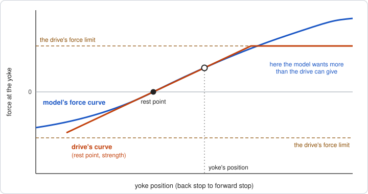

# How it works

For the curious pilot.

## The split: X-Plane flies the aircraft

X-Plane already computes the aircraft's lift, drag, downwash, propwash,
stall and how it balances in trim. Mesmer doesn't touch any of that and
never writes to the flight model.

What X-Plane does not compute is what the pilot's hand would feel: the
**hinge moment** of each control surface, the twist the air and the
surface's own weight put on it about its hinge, carried through the control
linkage to the yoke. That is all the plugin models. It reads from X-Plane:

- the air over the tail and over each aileron, panel by panel, including
  propwash: its dynamic pressure, angle of attack and whether X-Plane
  reports the panel stalled;
- the elevator trim setting;
- the load factor (g);

and from the yoke, where it is. Then it works out the force at the yoke and
where the yoke would come to rest with nobody holding it, and sets the
yoke's motors to match. The motors are real: read [SAFETY.md](../SAFETY.md)
before you turn force feel on.

## The elevator, in pilot's terms

Hold a Cessna 172's yoke and three things act on it:

1. **The elevator's weight.** The 172's elevator is a little heavier behind
   its hinge than in front of it. Parked with no air, it sags trailing edge
   down, and that pushes the yoke forward.
2. **The air's stiffness.** Deflect the elevator and the air pushes it back
   towards streamlined. The faster the air over the tail, the harder it
   pushes: the force grows with dynamic pressure, so twice the airspeed
   gives four times the stiffness. Propwash counts, which is why the yoke
   firms up on a run-up with the brakes on.
3. **The trim tab.** Trim deflects a small tab on the elevator's trailing
   edge, and the air on the tab floats the elevator the other way. So trim
   moves the place where the elevator, and the yoke, come to rest. In a well
   trimmed aircraft that place is where you want the yoke, and your hand can
   come off.

The model adds two finer effects: the tail's **angle of attack** floats the
elevator a little (more in a pull-up, where the tail meets the air at a
steeper angle), and a **stalled tail** keeps only part of the air's grip on
the elevator. With the air from behind, on a tailwind taxi or a ground
spin, the elevator runs to a stop the way a real one would.

## The ailerons

Each aileron is modelled the same way: the air over its own wing panels, its
weight and its angle of attack, about its own hinge. The two ailerons are
linked to the wheel, one going up while the other goes down, through a curve
that matches each aileron's up and down travel. The wheel feels the sum of
both hinge moments through that linkage. Parked with no air the wheel stays
where you leave it. In flight it centres, and in a bank its resting point
leans a little into the turn as the two wings meet the air differently.

## The solver: matching the motor to the model

The yoke's drive follows a force curve: how hard it pushes at each position along
the yoke's travel. The plugin sets that curve through a few settings: a **rest
point**, where the force is zero; a **strength**, how hard it pushes back as you
move away from the rest point; and an optional **constant force**, added along
the whole travel. The curve the yoke should follow is not a fixed one: it changes
with every simulation step. So the plugin keeps working out the curve and sends
the yoke a new one on each update. For pitch and for roll it does the following:

1. Read where the yoke is.
2. Work out, from the model, the force there and the yoke's **rest**, where
   the force would be zero with nobody holding it. If the weight pushes the
   yoke to a stop, the rest is that stop and the force there is the weight's.
3. Set the drive's curve so that it passes through both points: its rest
   point on the model's rest (with the constant force holding the weight's
   force when the rest is a stop), and its strength set so the force at the
   yoke's position matches the model's.

*The model's curve (blue) is matched by the drive's curve (orange) at the yoke's
position and at the rest point. Past the drive's force limit the drive can't
follow the model.*

The result: **the yoke always rests exactly where the model says**, and the
force under your hand is the model's, to within the drive's resolution and
one update's delay.

### When the model is stiffer than the drive

The drive can only produce so much force. It has its own protection limit
(roughly 20 lb at the grip), and the plugin keeps every command about 11%
under it, anywhere in the travel, counting the constant force. In cruise the
Cessna's real elevator would want more than 80 lb per inch: the force curve
asks the yoke for more force than the drive can produce. So when the model
asks for more, the strength stops at the drive's limit for that update. The
rest stays exact; the force is lighter than the model. The feel card says
*Saturated* and the feel page says *at the drive's limit*, with how stiff the
yoke is compared with the model.

### When the model is softer than the drive

The drive's lowest strength is 20%. Below that the yoke is firmer than the
model away from its rest (*Floored* on the card). Roll is placed so that the
wheel still feels the model's torque where it is.

### Changes the flight didn't make blend in

Force feel switching on, a new
[profile](configuration.md#brunnerdirectprofilesjson), or a figure changed on
the feel page blend over half a second, and each says what caused it on the
feel page and in X-Plane's corner.

### Trim

While force feel runs, the yoke's position already carries the trim (trim
moves the rest, and so the yoke), so the plugin tells X-Plane not to add its
own trim offset to the pitch input, on any aircraft. Your trim control still
sets X-Plane's trim, and the plugin never writes it. If another plugin already
holds that override, force feel stays off and the line says *Ready - force
feel off: another plugin holds the pitch trim*.

## Keeping the yoke working

A small supervisor runs from plugin start to stop and decides, every frame,
what the yoke should do and what the pilot is told:

- **No yoke:** keep looking, once a second.
- **Yoke found but not centred:** wait until X-Plane is running steadily
  (unpaused, physics advancing, controls free) and the yoke has been still
  for a second, show *Yoke centring - hands off*, then centre.
- **A controller fault:** stop the motors, then recover by itself at most
  twice (resting settings with the motors off, clear the fault, centre).
  After that, ask the pilot with one action, *Retry*.
- **Pause:** an engaged force-feel session holds. The motors stay on with the
  last curve settings and pitch force, the plugin stops updating them, and on resume
  there is nothing to rebuild. (The pitch and roll axes are released to
  X-Plane as before.) A session that has not started yet waits for the
  unpause. For the first 0.5 s after a pause, "controls not ready" is not
  believed, because the first frames have no fresh physics yet.
- **Aircraft change, or any real lapse** (controls lost, no frames for half a
  second): force feel is released and comes back by itself.

Every message the pilot sees comes from one status text, shared by the
menu, the corner line, the feel card and the feel page. The full list is in
[troubleshooting](troubleshooting.md).
